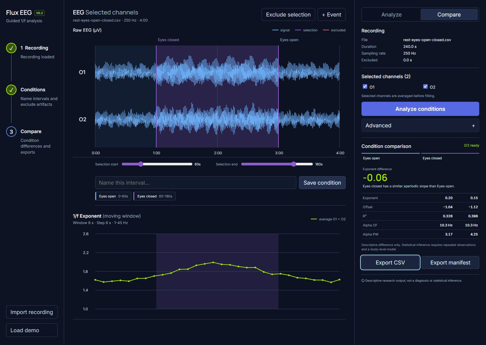

# Flux EEG

[](https://zenodo.org/badge/latestdoi/1335343804)

**Local-first EEG spectral analysis and experimental condition comparison**

Flux EEG is a browser-based research prototype for inspecting EEG recordings, estimating aperiodic (1/f-like) spectral structure, and comparing user-defined experimental conditions. It emphasizes **transparent methods, reproducible outputs, and conservative scientific interpretation**.



## Research purpose

Aperiodic EEG spectral features can be useful descriptive measures, but their interpretation depends on signal quality, modeling choices, and experimental design. Flux EEG makes those choices visible instead of presenting a single unexplained result.

The prototype is intended for exploratory research and method development. **It is not a diagnostic device, a consciousness detector, or a substitute for validated clinical EEG analysis.**

## Analysis foundation and V0.8 scope

- Import delimited OpenBCI recording data and inspect detected metadata.
- Review raw signals, choose channels and time intervals, and mark events.
- Estimate power spectral density using overlapping Hann-tapered Welch segments.
- Fit aperiodic spectral parameters alongside modeled oscillatory peaks.
- Inspect exponent, offset, model fit quality, alpha-peak estimates, and moving-window trends.
- Define named experimental conditions and mark artifact intervals for exclusion.
- Compare conditions descriptively, including underlying values and fit quality.
- Export results as CSV and a versioned JSON analysis manifest with provenance and warnings.

See the [V0.2 product specification](PRODUCT-SPEC.md) for feature scope, intended behavior, acceptance criteria, and limitations. Not every prospective capability should be interpreted as independently validated.

## Methodology and reproducibility

The [architecture notes](ARCHITECTURE.md) document the processing stages, planned validation, and comparison against Python scientific libraries. A [reference harness](reference/) is included for deterministic comparisons with SciPy and specparam. Numerical parity should be claimed **only when a corresponding validation report passes**.

Experiment conditions and exclusions should remain inspectable. Differences between conditions are descriptive; they do not establish significance, causality, or clinical meaning.

## Local privacy model

The documented prototype performs import, spectral estimation, fitting, and visualization in the browser. It does not require server-side EEG upload or an account. Check the current application implementation and deployment settings before using sensitive research data.

## Run locally

Requires Node.js 22.12 or newer and npm; CI uses Node.js 24.

```bash
npm ci
npm run dev
```

For a production build:

```bash
npm run build
```

The repository also includes a limited site/worker test command:

```bash
npm run test:sites
```

This does not replace scientific validation.

## Project context

Flux EEG is one part of an exploratory research portfolio involving neural signals, aperiodic dynamics, experimental visualization, and the boundaries between measurement and interpretation.

Related public work:

- [Living Field](https://github.com/SWALKERNURO/living-field) — an EEG/EOG condition-comparison research instrument.
- [Pink Noise Relational Field](https://github.com/SWALKERNURO/pink-noise-relational-field) — measured temporal EEG/EOG visualization and NoiseColor spectral analysis.

## Status

**Research prototype / active development.** See the code, [specification](PRODUCT-SPEC.md), [architecture](ARCHITECTURE.md), and [tests](tests/) for evidence of implementation and known limitations.

## Related interdisciplinary research

For the broader philosophy of mind and human–AI interaction agenda behind this research portfolio, see [Spencer H. Walker's research profile](https://github.com/SWALKERNURO/living-field/blob/main/RESEARCH-PROFILE.md). It includes a **proposed** study on AI conversational memory, naturalistic speech, contextual inference, and trust calibration; it is separate from the EEG methods and evidence documented here.

## V0.8 desktop and experiment workflow

## Run the web app

```text
npm ci
npm run dev
```

## Run or package the Windows app

```text
npm run desktop
npm run desktop:build
```

The installer is created at `installer-output/Flux-EEG-0.8.0-Setup.exe`. See [DESKTOP.md](DESKTOP.md) for serial-device and signing details.

## Verify the project

```text
npm run build
npm test
npm run test:sites
npm run desktop:test
```

The analysis implementation and trust boundaries are documented in [ARCHITECTURE.md](ARCHITECTURE.md), while the product scope is recorded in [PRODUCT-SPEC.md](PRODUCT-SPEC.md).

## Dependency and CI maintenance

CI builds and tests the web application, audits the complete dependency tree, builds the unsigned Windows installer, and smoke-tests the packaged application. The targeted minimatch override patches the Electron packaging dependency graph without downgrading electron-builder. Remove it when the upstream packaging dependencies require a patched version. These software checks do not establish scientific or clinical validity.
